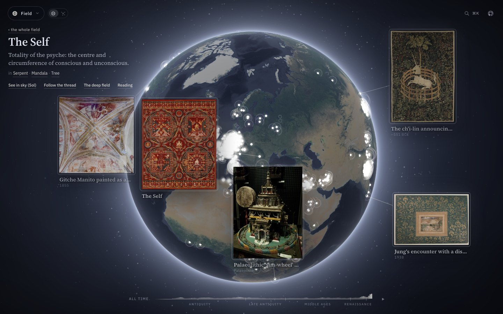

# An Archetypal Earth

**[jung.epi-logos.org](https://jung.epi-logos.org)**

[](https://jung.epi-logos.org)

[Watch the 70-second tour](docs/video/archetypal-earth-tour.mp4): the Anima, its reading, across to the Moon's sky and back down to Earth by way of the Great Mother.

I built this to see Jung's whole field in one place: every archetype, symbol and instance he wrote about, set where and when it appeared and cited to the page. Everything in it connects back to one centre, which Jung called the Self. That's where it starts.

Nobody can hold that field in their head. The *Collected Works* scatter it across twenty volumes and forty years of revision, and Jung's own method, amplification, needs the parallels lined up side by side before the pattern shows itself. This site lines them up. Pick a symbol (the serpent, the mandala, the philosopher's stone) and read its path through time and cultures, each stop cited to the volume, paragraph and page where he wrote it.

## What it holds

The field is built from the Collected Works (vols. 1–18, both halves of 9), the six seminars, the Pauli letters, the Zofingia lectures and *Synchronicity*, with the Red Book beside them. Neumann, von Franz, Van Eenwyk, Burt's zodiac and Crowley's *Book of Thoth* are read in beside Jung as commentary and as the sources for the number, sky and card work, always marked as theirs.

- **27 archetypes**, **559 image families** beneath them (mandala, serpent, ouroboros, conjunctio, the signs, the elements, the Thoth cards), and **3,085 dated occurrences**, on the Earth and in the sky: a pyramid text, a gnostic diagram, an alchemical woodcut, a dream told at the Zürich seminar table, a card on Mars’s decan wheel.
- **14 theoretics**, Jung's instruments (the psychoid, the collective unconscious, synchronicity, the transcendent function) carried as part of the field rather than left in a glossary.
- Plates for the images, each credited on the site to its museum, photographer or publisher.

The tiers follow Jung's own epistemology: the archetype *as such* is irrepresentable and known only through the images that express it, so instances attach to images, never to an archetype directly.

## Ways of reading it

One globe, one centre, several lenses. The menu at the top left switches between them; `⌘K` searches; the strip along the bottom moves the whole field through time; the toggle beside the menu turns the globe into the graph.

| | |
|---|---|
| **Field** | Every archetype, symbol and instance on the globe. |
| **Theory** | How psychic energy moves, and number as an archetype. |
| **Alchemy** | The opus from nigredo to rubedo, its operations and matter. |
| **Aion** | Jung's history of the aeons, Pisces to Aquarius. |
| **Red Book** | The book the rest of the field grew from. |
| **Astrology** | Your birth sky beside Jung's, read through the corpus. |
| **Dreams** | Keep your dreams and amplify their images. |
| **Symbols** | Take one symbol through its history and doctrine. |
| **Coincidences** | Log meaningful coincidences and see your series. |

The first five read the field; the last four are yours to bring material to. Your birth data, dreams and coincidences live in your browser's local storage and never reach a server. Any subject opens into its thread through time, its deeper page, and where it sits in the sky.

## Principles

- **Every claim is cited**, to volume, paragraph and page, and the citations are machine-checked against the extracted texts.
- **Contradictions are kept.** Jung revised constantly; where his thought splits, both strata are shown with their dates.
- **Jung's words and the scholarship stay apart.** In the cross-cultural tables, claims from his text are marked **J** and claims from standard scholarship **S**; the QL framework's own words are marked as such.

## Provenance

A personal research edition, built from lawfully owned copies of the Princeton/Bollingen and Routledge editions. The site carries short cited quotations, not the works: the editions themselves remain the court of appeal, and the full texts are not published here. Globe imagery: NASA.

## Run it

```bash
npm install
npm run dev        # http://localhost:5181
```

The data is baked into `public/data/` from a local research vault; how it is rebuilt and deployed is in [ProjectCentral/docs/DEPLOY.md](ProjectCentral/docs/DEPLOY.md), and the original site brief is [docs/SPEC.md](docs/SPEC.md).
